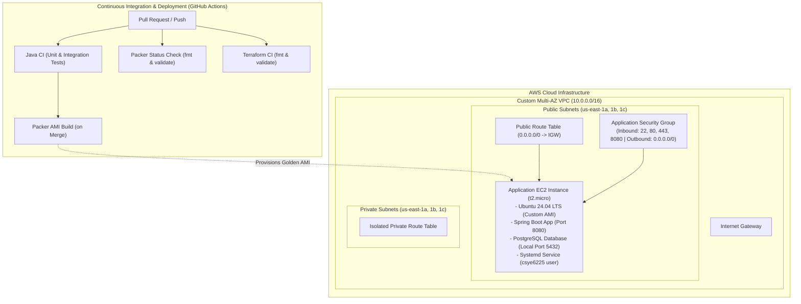

# Cloud-Native Web Application & AWS Infrastructure

A production-grade, cloud-native application ecosystem combining a secure Spring Boot REST API, automated golden Amazon Machine Image (AMI) creation with HashiCorp Packer, and reproducible multi-AZ AWS Cloud Infrastructure provisioning with HashiCorp Terraform.

---

## Architecture Overview



### End-to-End Workflow

1. **Backend Application**: Built with Java 17 and Spring Boot. Exposes stateless REST endpoints for health monitoring, user registration, profile management, and product catalog operations. Secured with HTTP Basic Authentication and salted BCrypt password hashing.
2. **Automated Schema Management**: Bootstraps the database automatically on startup via Spring Data JPA and Hibernate ORM. No manual SQL script execution is required.
3. **Golden AMI Baking (Packer)**: Creates immutable Ubuntu 24.04 LTS images pre-configured with OpenJDK 21, local PostgreSQL, a non-login service account (`csye6225`), hardened directory permissions, and a systemd service configured for auto-restart on failure.
4. **Infrastructure as Code (Terraform)**: Declaratively provisions a 3-tier capable network topology in AWS comprising a custom VPC, 3 public subnets, 3 private subnets across 3 Availability Zones, Internet Gateway, route tables, security groups, and an EC2 instance booted with the custom AMI.
5. **CI/CD Quality Gates (GitHub Actions)**: Automated pipelines validate code formatting, execute test suites against real PostgreSQL service containers, verify Packer templates, and validate Terraform definitions.

---

## Repository Structure

```text
cloud-native-project/
├── docs/                               # Architectural reference specifications
├── productcatalog-api/                 # Backend REST API & Golden AMI configuration
│   ├── .github/workflows/
│   │   ├── ci.yml                      # Build & Integration test pipeline with PostgreSQL
│   │   ├── packer-check.yml            # Packer formatting and validation check
│   │   └── packer-build.yml            # Automated AMI build on merge
│   ├── src/
│   │   ├── main/java/                  # Controllers, Entities, Repositories, Services, DTOs
│   │   │   └── com/akshay/productcatalog/productcatalogapi/
│   │   │       ├── config/             # Security and application configurations
│   │   │       ├── controller/         # REST Controllers & Global Exception Handler
│   │   │       ├── dto/                # Request and Response transfer objects
│   │   │       ├── entity/             # JPA Entities (User, Product, HealthCheck)
│   │   │       ├── exception/          # Custom exceptions
│   │   │       ├── repository/         # Spring Data JPA Repositories
│   │   │       ├── security/           # UserDetailsService & Auth Providers
│   │   │       └── service/            # Core business logic
│   │   └── main/resources/
│   │       └── application.properties  # Database & JPA configurations
│   ├── aws-ubuntu.pkr.hcl              # HashiCorp Packer template for Ubuntu 24.04
│   ├── setup.sh                        # AMI provisioning and OS hardening script
│   ├── productcatalog.service          # Systemd unit file for background service
│   ├── pom.xml                         # Maven project dependencies and build plugins
│   └── README.md                       # API component documentation
├── tf-aws-infra/                       # AWS Infrastructure as Code (Terraform)
│   ├── .github/workflows/
│   │   └── terraform-ci.yml            # Terraform formatting & syntax validation
│   ├── main.tf                         # VPC, Subnets, Gateways, Route Tables, SG, EC2
│   ├── variables.tf                    # Parameterized variables
│   ├── outputs.tf                      # Exported infrastructure outputs
│   ├── provider.tf                     # AWS Provider declaration
│   ├── versions.tf                     # Version constraints (Terraform >= 1.6, AWS ~> 6.0)
│   ├── terraform.tfvars                # Environment configuration variables
│   └── README.md                       # Terraform component documentation
├── .gitignore                          # Global exclusion rules (IDE, build artifacts, secrets)
└── README.md                           # Master project documentation
```

---

## Core Technologies & System Design

### Technology Stack

| Layer | Technologies |
|-------|--------------|
| **Runtime & Language** | Java 17 / OpenJDK 21 Headless |
| **Framework** | Spring Boot 4.0.x (Web, Security, Data JPA) |
| **Database** | PostgreSQL 14+ |
| **ORM / Migrations** | Hibernate ORM (Automated schema bootstrapping) |
| **Image Automation** | HashiCorp Packer (Amazon EBS builder) |
| **Infrastructure as Code** | HashiCorp Terraform (AWS Provider) |
| **CI/CD** | GitHub Actions |
| **Testing** | JUnit 5, Spring Boot Test, MockMvc, AssertJ |

### Cloud-Native Design Principles Implemented

- **Stateless Architecture**: No server-side session state is stored; each request carries full authentication credentials.
- **Externalized Configuration**: Database connection URLs, credentials, and ports are read from environment variables (`DB_URL`, `DB_USERNAME`, `DB_PASSWORD`), with fallbacks for local development.
- **Zero Manual Database Setup**: Tables (`users`, `products`, `health_checks`) are automatically generated and synchronized during application startup without manual SQL execution.
- **Principle of Least Privilege**:
  - The application executes under a dedicated system user (`csye6225`) with `/usr/sbin/nologin`.
  - Directory permissions on `/opt/csye6225` are restricted to `750`, and binary JAR permissions to `640`.
  - The PostgreSQL port (`5432`) is bounded to internal host communications and is **never** exposed through the AWS EC2 security group.
- **Immutable Infrastructure**: Changes are deployed by building clean golden AMIs with Packer rather than making in-place modifications to live servers.
- **Attack Surface Minimization**: Build utilities and VCS tools (such as `git`) are purged from production images during AMI provisioning.

---

## API Specification & Endpoints

### 1. Health Monitoring (`/healthz`)

Validates application readiness and underlying database connectivity.

- **Method**: `GET`
- **Supported Methods**: `GET` only (other methods return `405 Method Not Allowed`).
- **Payload**: No request body or query parameters permitted (returns `400 Bad Request` if present).
- **Behavior**: Inserts a new timestamped record into the `health_checks` table (`check_id`, `check_datetime`).
- **Response**: Empty body with cache headers:
  ```http
  HTTP/1.1 200 OK
  Cache-Control: no-cache, no-store, must-revalidate;
  Pragma: no-cache
  X-Content-Type-Options: nosniff
  Content-Length: 0
  ```
- **Error Cases**: Returns `503 Service Unavailable` if database connectivity fails.

### 2. User Management (`/v1/user`)

| Method | Endpoint | Auth | Success Code | Description |
|--------|----------|------|--------------|-------------|
| `POST` | `/v1/user` | None | `201 Created` | Register a new user account |
| `GET` | `/v1/user/self` | Basic Auth | `200 OK` | Fetch authenticated user's profile |
| `PUT` | `/v1/user/self` | Basic Auth | `204 No Content` | Update authenticated user's details |

- **Username Requirement**: The username must be a valid email address.
- **Password Security**: Passwords are encrypted with BCrypt and unique salt. The password is never returned in any response payload.
- **System-Managed Fields**: `account_created` and `account_updated` timestamps are read-only and managed exclusively by the application.
- **Field Updatability**: Only `first_name`, `last_name`, and `password` can be updated. Attempting to modify other fields returns `400 Bad Request`.

### 3. Product Catalog (`/v1/product`)

| Method | Endpoint | Auth | Success Code | Description |
|--------|----------|------|--------------|-------------|
| `POST` | `/v1/product` | Basic Auth | `201 Created` | Create a new catalog product |
| `GET` | `/v1/product/{id}` | Basic Auth | `200 OK` | Retrieve product details by ID |
| `PUT` | `/v1/product/{id}` | Basic Auth | `204 No Content` | Update product (creator only) |
| `DELETE`| `/v1/product/{id}` | Basic Auth | `204 No Content` | Delete product (creator only) |

- **Ownership & Authorization**: Only the user who created a product can modify or delete it. Attempts by other users return `403 Forbidden`.
- **Validation**: Product `quantity` must be an integer greater than or equal to `0`. `sku` must be unique.

---

## Example API Requests

### Health Check

```bash
curl -i -X GET http://localhost:8080/healthz
```

### Register New User

```bash
curl -i -X POST http://localhost:8080/v1/user \
  -H "Content-Type: application/json" \
  -d '{
    "first_name": "Jane",
    "last_name": "Doe",
    "username": "jane.doe@example.com",
    "password": "SecurePassword123!"
  }'
```

### Retrieve User Profile

```bash
curl -i -X GET http://localhost:8080/v1/user/self \
  -u "jane.doe@example.com:SecurePassword123!"
```

### Update User Profile

```bash
curl -i -X PUT http://localhost:8080/v1/user/self \
  -u "jane.doe@example.com:SecurePassword123!" \
  -H "Content-Type: application/json" \
  -d '{
    "first_name": "Jane",
    "last_name": "Smith",
    "password": "NewSecurePassword456!"
  }'
```

### Create Product

```bash
curl -i -X POST http://localhost:8080/v1/product \
  -u "jane.doe@example.com:NewSecurePassword456!" \
  -H "Content-Type: application/json" \
  -d '{
    "name": "Wireless Mechanical Keyboard",
    "description": "75% compact wireless keyboard with hot-swappable switches",
    "sku": "KB-WL-75",
    "manufacturer": "KeyCraft",
    "quantity": 25
  }'
```

### Get Product

```bash
curl -i -X GET http://localhost:8080/v1/product/1 \
  -u "jane.doe@example.com:NewSecurePassword456!"
```

### Update Product

```bash
curl -i -X PUT http://localhost:8080/v1/product/1 \
  -u "jane.doe@example.com:NewSecurePassword456!" \
  -H "Content-Type: application/json" \
  -d '{
    "name": "Wireless Mechanical Keyboard Pro",
    "description": "Updated model with RGB backlighting",
    "sku": "KB-WL-75-PRO",
    "manufacturer": "KeyCraft",
    "quantity": 30
  }'
```

### Delete Product

```bash
curl -i -X DELETE http://localhost:8080/v1/product/1 \
  -u "jane.doe@example.com:NewSecurePassword456!"
```

---

## Local Setup & Development

### Prerequisites

- **Java JDK**: 17+
- **Maven**: 3.8+ (or use the included `./mvnw`)
- **PostgreSQL**: 14+
- **HashiCorp Packer**: 1.9+
- **HashiCorp Terraform**: 1.6+
- **AWS CLI**: v2+

### 1. Database Setup

Ensure PostgreSQL is running locally and create the database:

```sql
CREATE DATABASE productcatalog_db;
```

### 2. Configure Environment Variables

```bash
export DB_URL="jdbc:postgresql://localhost:5432/productcatalog_db"
export DB_USERNAME="postgres"
export DB_PASSWORD="your_postgres_password"
```

### 3. Run Application Locally

```bash
cd productcatalog-api
./mvnw spring-boot:run
```

The application starts on `http://localhost:8080`.

### 4. Run Test Suite

Execute the complete integration test suite:

```bash
./mvnw clean test
```

---

## AWS CLI Configuration

To prevent unintended operations against incorrect AWS environments, avoid using a `default` AWS profile. Instead, configure named profiles:

```bash
# Development profile
aws configure --profile dev

# Demonstration / Production profile
aws configure --profile demo
```

Always pass the profile explicitly:
```bash
aws ec2 describe-instances --profile dev
```

---

## Building the Golden AMI with Packer

The AMI build pipeline packages the application and its dependencies into a custom Ubuntu 24.04 image.

1. **Build Application JAR**:
   ```bash
   cd productcatalog-api
   mvn clean package -DskipTests
   ```

2. **Initialize and Validate Packer Template**:
   ```bash
   packer init .
   packer fmt -check .
   packer validate .
   ```

3. **Build AMI**:
   ```bash
   packer build -var="aws_region=us-east-1" aws-ubuntu.pkr.hcl
   ```
   *Note: Packer will output the created AMI ID (e.g. `ami-0123456789abcdef0`).*

---

## Provisioning Infrastructure with Terraform

The Terraform module creates a completely parameterized, multi-AZ network and compute stack.

1. **Navigate to Infrastructure Directory**:
   ```bash
   cd tf-aws-infra
   ```

2. **Configure Variables (`terraform.tfvars`)**:
   ```hcl
   aws_region  = "us-east-1"
   aws_profile = "dev"
   vpc_cidr    = "10.0.0.0/16"
   vpc_name    = "dev-vpc"

   public_subnet_cidrs  = ["10.0.1.0/24", "10.0.2.0/24", "10.0.3.0/24"]
   private_subnet_cidrs = ["10.0.11.0/24", "10.0.12.0/24", "10.0.13.0/24"]
   availability_zones   = ["us-east-1a", "us-east-1b", "us-east-1c"]

   # Use the AMI ID produced from the Packer build
   ami_id = "ami-0123456789abcdef0"
   ```

3. **Deploy Resources**:
   ```bash
   # Initialize Terraform provider plugins
   terraform init

   # Validate code syntax and formatting
   terraform fmt -check
   terraform validate

   # Review execution plan
   terraform plan -out=tfplan

   # Apply changes
   terraform apply tfplan
   ```

4. **Verify Application in Cloud**:
   ```bash
   curl -i http://<EC2_PUBLIC_IP>:8080/healthz
   ```

5. **Clean Up Resources**:
   ```bash
   terraform destroy
   ```

---

## CI/CD Pipeline Standards

GitHub Actions automate verification across every repository component:

- **Java CI (`ci.yml`)**: Triggered on push and pull requests to `master`. Launches a PostgreSQL container, executes `mvn clean verify`, and ensures zero compiler or test regressions.
- **Packer Status Check (`packer-check.yml`)**: Enforces formatting (`packer fmt -check`) and validates HCL syntax on pull requests.
- **Packer AMI Build (`packer-build.yml`)**: Triggered on merge to `master`. Runs tests, builds the JAR on the runner (never cloned inside the AMI), and bakes the new AMI in AWS.
- **Terraform CI (`terraform-ci.yml`)**: Executes on pull requests to ensure formatting (`terraform fmt -check -recursive`) and configuration correctness (`terraform validate`).

---

## Architecture Evolution & Roadmap

This project is architected for modular expansion into high-scale cloud-native patterns:

1. **Managed Database (Amazon RDS)**: Transition local PostgreSQL to a managed, private Multi-AZ Amazon RDS PostgreSQL instance with security groups allowing ingress exclusively from the application security group.
2. **Object Storage (Amazon S3)**: Attach private S3 buckets with default SSE-S3 encryption and lifecycle transitions (Standard to Standard-IA after 30 days) for product image attachments, accessed securely via IAM instance roles.
3. **Observability & Metrics (Amazon CloudWatch)**: Integration of the Unified CloudWatch Agent and StatsD for shipping structured application logs and publishing custom API latency/throughput metrics.
4. **Resilience & High Availability**: Auto Scaling Groups (ASG) fronted by an Application Load Balancer (ALB) with Route 53 DNS routing and TLS certificate termination.
5. **Event-Driven Serverless**: Publishing domain events (e.g. user registration) via Amazon SNS to trigger AWS Lambda functions for asynchronous notifications and token verifications.

---

## License

This project is licensed under the MIT License.
