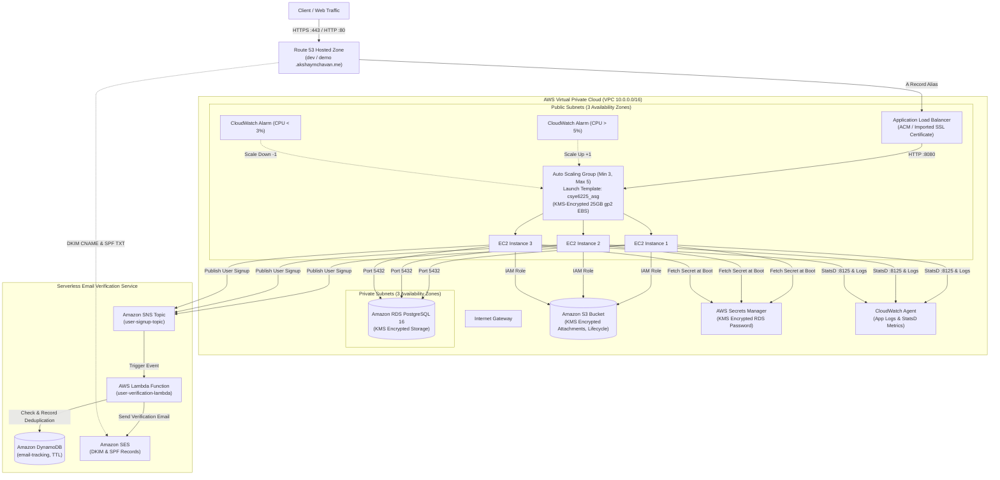

# Cloud-Native Web Application & AWS Infrastructure

A production-grade, highly available, secure cloud-native application ecosystem combining a Spring Boot REST API, automated golden Amazon Machine Image (AMI) creation with HashiCorp Packer, serverless event-driven email verification, and reproducible multi-AZ AWS Cloud Infrastructure provisioning with HashiCorp Terraform.

---

## Architecture Overview



### End-to-End Workflow

1. **Backend Application**: Built with Java 17 and Spring Boot. Exposes stateless REST endpoints for health monitoring, user registration, profile management, product catalog operations, product image attachments, and email verification. Secured with HTTP Basic Authentication and salted BCrypt password hashing.
2. **Automated Schema Management**: Bootstraps the database automatically on startup via Spring Data JPA and Hibernate ORM.
3. **Golden AMI Baking (Packer)**: Builds hardened Ubuntu 24.04 LTS images pre-configured with OpenJDK 17, CloudWatch Unified Agent, systemd service unit, and dedicated non-login service account (`csye6225`). Automatically shares AMIs with the Demo AWS account.
4. **Cloud Infrastructure as Code (Terraform)**: Declaratively provisions a 3-tier network topology across 3 Availability Zones, 4 Customer-Managed KMS Keys with 90-day automatic rotation, AWS Secrets Manager, private RDS PostgreSQL, private KMS-encrypted S3 with lifecycle transitions, Application Load Balancer with SSL/TLS termination, Auto Scaling Group with CPU alarms, Route 53 DNS aliases, and Amazon SES.
5. **Serverless Event-Driven Architecture**: User registration publishes events to Amazon SNS. An AWS Lambda function deduplicates requests using Amazon DynamoDB (with TTL) and dispatches verification emails via Amazon SES containing a 1-minute expiration link (`GET /validateEmail`).
6. **Zero-Downtime Rolling Deployment (CI/CD)**: GitHub Actions executes unit and integration tests, bakes new AMIs in Dev, shares them with Demo, creates new Launch Template versions in Demo, and issues an AWS Auto Scaling Instance Refresh with active status polling.

---

## Repository Structure

```text
cloud-native-project/
├── docs/                               # Assignment specification documents (01 - 09)
├── productcatalog-api/                 # Backend REST API & Golden AMI configuration
│   ├── .github/workflows/
│   │   ├── ci.yml                      # Integration tests against PostgreSQL container
│   │   ├── packer-check.yml            # Packer formatting & syntax validation
│   │   └── packer-build.yml            # AMI build, Demo LT update & Instance Refresh
│   ├── src/main/java/                  # Spring Boot source code (Controllers, Services, DTOs)
│   ├── src/main/resources/             # Application configuration & metrics setup
│   ├── src/test/java/                  # REST Assured integration test suite
│   ├── aws-ubuntu.pkr.hcl              # Packer template with Demo sharing & manifest
│   ├── amazon-cloudwatch-agent.json    # CloudWatch Unified Agent metrics/logs schema
│   ├── setup.sh                        # AMI provisioning & OS hardening script
│   ├── productcatalog.service          # Systemd service unit definition
│   ├── pom.xml                         # Maven dependencies (Spring Boot, AWS SDKs)
│   └── README.md                       # API documentation
├── serverless/                         # Serverless Email Verification Service
│   ├── .github/workflows/
│   │   └── deploy-lambda.yml           # Automated Lambda build and deployment workflow
│   ├── index.js                        # SNS handler, DynamoDB deduplication & SES dispatch
│   ├── package.json                    # Node.js 20 AWS SDK v3 dependencies
│   └── README.md                       # Serverless service documentation
├── tf-aws-infra/                       # AWS Infrastructure as Code (Terraform)
│   ├── .github/workflows/
│   │   └── terraform-ci.yml            # Terraform format & syntax validation
│   ├── main.tf                         # VPC, KMS, Secrets, ALB, ASG, RDS, S3, SNS, Lambda, SES
│   ├── variables.tf                    # Parameterized input variables
│   ├── outputs.tf                      # Exported infrastructure outputs
│   ├── provider.tf                     # AWS Provider declaration
│   ├── versions.tf                     # Version constraints (AWS ~> 5.0, archive ~> 2.4)
│   ├── terraform.tfvars                # Dev environment configuration
│   ├── demo.tfvars                     # Demo environment configuration (Imported SSL)
│   └── README.md                       # Terraform component documentation
├── .gitignore                          # Global exclusion rules
└── README.md                           # Master project documentation
```

---

## API Specification & Endpoints

| Method | Endpoint | Authentication | Description |
|:---|:---|:---:|:---|
| `GET` | `/healthz` | None | Application readiness & PostgreSQL database connectivity check |
| `POST` | `/v1/user` | None | Registers user account and publishes signup event to SNS |
| `GET` | `/v1/user/{userId}` | Basic Auth | Fetches user profile (accessible by account owner only) |
| `PUT` | `/v1/user/{userId}` | Basic Auth | Updates user profile (`first_name`, `last_name`, `password`) |
| `GET` | `/validateEmail?email={email}&token={token}` | None | Verifies user account token within 1-minute expiration |
| `POST` | `/v1/product` | Basic Auth | Creates a new catalog product |
| `GET` | `/v1/product/{id}` | Basic Auth | Retrieves product details by ID |
| `PUT` | `/v1/product/{id}` | Basic Auth | Full product update (creator only) |
| `PATCH`| `/v1/product/{id}` | Basic Auth | Partial product update (creator only) |
| `DELETE`| `/v1/product/{id}` | Basic Auth | Deletes product (creator only) |
| `POST` | `/v1/product/{productId}/image` | Basic Auth | Uploads product image attachment to S3 |
| `GET` | `/v1/product/{productId}/image` | Basic Auth | Lists image attachment metadata for product |
| `GET` | `/v1/product/{productId}/image/{imageId}` | Basic Auth | Retrieves single image attachment metadata |
| `DELETE`| `/v1/product/{productId}/image/{imageId}` | Basic Auth | Deletes image attachment from S3 and database |

---

## Security & Encryption Architecture

1. **Customer-Managed KMS Keys (CMKs)**:
   - 4 independent CMKs with **90-day automatic key rotation** (`rotation_period_in_days = 90`):
     - `kms/ec2`: Encrypts root EBS volumes (25GB gp2) attached to EC2 instances in the Auto Scaling Group.
     - `kms/rds`: Encrypts RDS PostgreSQL database storage and snapshots.
     - `kms/s3`: Encrypts S3 bucket objects with server-side encryption.
     - `kms/secretsmanager`: Encrypts database credentials in AWS Secrets Manager.
2. **AWS Secrets Manager**:
   - Randomly generated 16-character database password stored in Secrets Manager.
   - EC2 instances query Secrets Manager dynamically at boot via AWS CLI within `user_data` to configure `application.env`. No passwords are hardcoded in Git.
3. **Network Isolation**:
   - RDS PostgreSQL is provisioned inside private subnets with no public IP.
   - Database security group permits traffic on port 5432 **strictly** from the Application Security Group.
   - Application Security Group permits HTTP port 8080 **strictly** from the Load Balancer Security Group. Direct public HTTP access to EC2 is disabled.
4. **SSL / TLS Termination**:
   - Application Load Balancer terminates TLS on port 443.
   - Dev environment validates ACM certificates automatically via Route 53 DNS records.
   - Demo environment supports external certificates (e.g. Let's Encrypt / Certbot) imported into ACM via AWS CLI.

---

## Local Development & Testing

### 1. Run Tests Locally
```bash
# Verify all 44 unit and integration tests
mvn clean verify -f productcatalog-api/pom.xml
```

### 2. Validate Packer Golden AMI Template
```bash
cd productcatalog-api
packer init .
packer fmt -check .
packer validate .
```

### 3. Validate Terraform Cloud Infrastructure
```bash
cd tf-aws-infra
terraform init
terraform fmt -check -recursive
terraform validate
```

---

## Infrastructure Deployment

### Deploy to Dev Environment
```bash
cd tf-aws-infra
terraform plan
terraform apply
```

### Deploy to Demo Environment
```bash
cd tf-aws-infra
terraform plan -var-file="demo.tfvars"
terraform apply -var-file="demo.tfvars"
```

### Clean Up Resources
```bash
terraform destroy -var-file="demo.tfvars"
```

---

## License

This project is licensed under the MIT License.
