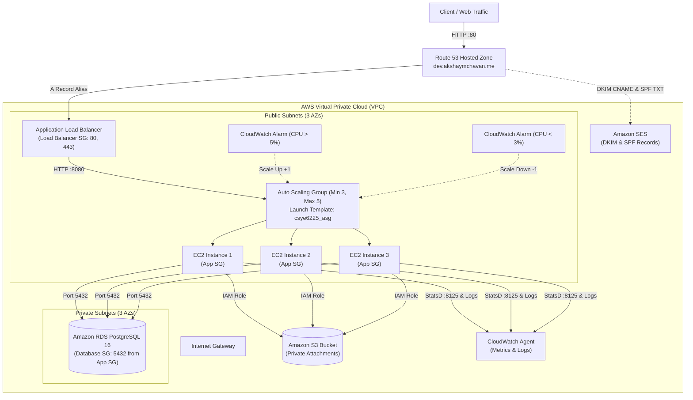

# AWS Cloud Infrastructure (Terraform)

This directory contains HashiCorp Terraform modules to automate the provisioning of an auto-scaling, highly available, secure cloud application stack on Amazon Web Services (AWS) using an Application Load Balancer, Launch Template, Auto Scaling Group, Route 53 DNS alias, RDS PostgreSQL, S3, and Amazon SES.

---

## Architecture



### Components

1. **VPC & Subnets**:
   - VPC configured with DNS support and DNS hostnames enabled.
   - **Public Subnets**: 3 public subnets distributed across 3 Availability Zones with public IP assignment enabled.
   - **Private Subnets**: 3 isolated private subnets across 3 Availability Zones for backend databases.
   - Internet Gateway attached to the VPC with public route table (`0.0.0.0/0 -> IGW`).
2. **Security Groups**:
   - **Load Balancer Security Group**: Ingress allowed on ports `80` (HTTP) and `443` (HTTPS) from `0.0.0.0/0`. Full egress allowed.
   - **Application Security Group**: Ingress on application port (`8080`) allowed **strictly from the Load Balancer Security Group**. Direct HTTP access from the public internet is disabled. Ingress on port `22` (SSH) is enabled for administration.
   - **Database Security Group**: Ingress on port `5432` allowed strictly and exclusively from the Application Security Group.
3. **Application Load Balancer (ALB)**:
   - Internet-facing Application Load Balancer deployed across the public subnets.
   - Listens on HTTP port `80` and forwards traffic to the Target Group.
   - Target Group routes to port `8080` with continuous health checks on `/healthz` (interval 30s, timeout 5s, healthy threshold 2, unhealthy threshold 3).
4. **Launch Template (`csye6225_asg`)**:
   - Custom AMI ID specified by `var.ami_id`.
   - Instance type (`t2.micro`), key name, and public IP assignment enabled.
   - Attached to the Application Security Group and IAM instance profile with CloudWatch Agent and S3 permissions.
   - Root Block Device: `25 GB` GP2 EBS volume configured with `delete_on_termination = true`.
   - Base64 user data automatically injects `/opt/csye6225/application.env`, initializes CloudWatch agent, and starts the systemd service.
5. **Auto Scaling Group (ASG)**:
   - Minimum size: `3`, Maximum size: `5`, Desired capacity: `3`.
   - Cooldown period: `60 seconds`.
   - EC2 instances launched across the public subnets and attached to the ALB Target Group.
   - Instances tagged with `propagate_at_launch = true`.
6. **Auto Scaling Policies & CloudWatch Alarms**:
   - **Scale Up**: Simple scaling policy increments instance count by `1` with a `60` second cooldown when average `CPUUtilization > 5%`.
   - **Scale Down**: Simple scaling policy decrements instance count by `1` with a `60` second cooldown when average `CPUUtilization < 3%`.
7. **Route 53 DNS Configuration**:
   - Dynamically resolves the hosted zone for `var.domain_name` (e.g. `dev.akshaymchavan.me`).
   - Creates an `A` record alias pointing to the Application Load Balancer DNS name with `evaluate_target_health = true`.
   - Accessible via root context: `http://dev.akshaymchavan.me/`.
8. **Amazon SES & Email Verification (DKIM & SPF)**:
   - Sets up SES domain identity for `var.domain_name`.
   - Automatically provisions 3 DKIM CNAME records in Route 53.
   - Configures an SPF TXT record (`v=spf1 include:amazonses.com ~all`) in Route 53.
9. **Private S3 Bucket**:
   - UUID-named private S3 bucket with default AES256 server-side encryption.
   - S3 Lifecycle Rule transitioning objects to `STANDARD_IA` after 30 days.
   - `force_destroy = true` for clean teardown.
   - All public access strictly blocked.
10. **Amazon RDS PostgreSQL**:
    - PostgreSQL 16.x (`db.t4g.micro`, 20GB storage).
    - Multi-AZ disabled, deployed inside private DB subnet group.
    - Custom parameter group and auto-generated secure credentials.

---

## File Structure

```text
tf-aws-infra/
├── .github/workflows/
│   └── terraform-ci.yml    # GitHub Actions workflow for PR format & validation checks
├── main.tf                 # Core infrastructure (VPC, ALB, ASG, Launch Template, S3, RDS, SES, Route 53)
├── variables.tf            # Input variable declarations and defaults
├── outputs.tf              # Exported resource identifiers
├── provider.tf             # AWS provider configuration
├── versions.tf             # Terraform and provider version requirements
├── terraform.tfvars        # Environment variable definitions
└── README.md               # Infrastructure documentation
```

---

## Input Variables

| Name | Type | Description | Default |
|------|------|-------------|---------|
| `aws_region` | `string` | AWS region where resources will be created | - |
| `aws_profile` | `string` | AWS CLI profile to use for authentication | - |
| `vpc_cidr` | `string` | CIDR block for the custom VPC | - |
| `vpc_name` | `string` | Name prefix used for tagging resources | - |
| `public_subnet_cidrs` | `list(string)` | CIDR blocks for public subnets (3 AZs) | - |
| `private_subnet_cidrs` | `list(string)` | CIDR blocks for private subnets (3 AZs) | - |
| `availability_zones` | `list(string)` | Availability zones corresponding to subnets | - |
| `ami_id` | `string` | ID of the custom golden AMI to boot | - |
| `domain_name` | `string` | Subdomain for Route 53 zone (e.g. `dev.akshaymchavan.me`) | - |
| `key_name` | `string` | EC2 Key Pair name for SSH access | `null` |
| `instance_type` | `string` | EC2 instance type for launch template | `"t2.micro"` |
| `app_port` | `number` | Port on which the Spring Boot application listens | `8080` |
| `asg_min_size` | `number` | Minimum number of instances in ASG | `3` |
| `asg_max_size` | `number` | Maximum number of instances in ASG | `5` |
| `asg_desired_capacity` | `number` | Desired number of instances in ASG | `3` |

---

## Output Values

| Name | Description |
|------|-------------|
| `vpc_id` | ID of the created VPC |
| `public_subnet_ids` | List of IDs of created public subnets |
| `private_subnet_ids` | List of IDs of created private subnets |
| `internet_gateway_id` | ID of the Internet Gateway |
| `public_route_table_id` | ID of the public route table |
| `private_route_table_id` | ID of the private route table |
| `s3_bucket_name` | Name of the S3 bucket created for attachments |
| `rds_endpoint` | Endpoint of the RDS PostgreSQL instance |
| `rds_address` | Hostname of the RDS PostgreSQL instance |
| `database_security_group_id` | ID of the database security group |
| `load_balancer_sg_id` | ID of the Load Balancer security group |
| `application_sg_id` | ID of the Application security group |
| `alb_dns_name` | DNS name of the Application Load Balancer |
| `alb_zone_id` | Hosted zone ID of the Application Load Balancer |
| `route53_app_fqdn` | FQDN of the Route 53 A record alias pointing to ALB |
| `autoscaling_group_name` | Name of the Auto Scaling Group |
| `launch_template_name` | Name of the Launch Template |

---

## Verification & Usage

### 1. Initialize & Validate
```bash
terraform init
terraform fmt -check
terraform validate
```

### 2. Plan Infrastructure
```bash
terraform plan
```

### 3. Apply Infrastructure
```bash
terraform apply
```

### 4. Verify Route 53 DNS & Email Setup
```bash
# Query A record alias
dig A dev.akshaymchavan.me

# Query SPF TXT record
dig TXT dev.akshaymchavan.me

# Verify HTTP access through ALB via domain name
curl -i http://dev.akshaymchavan.me/healthz
```
