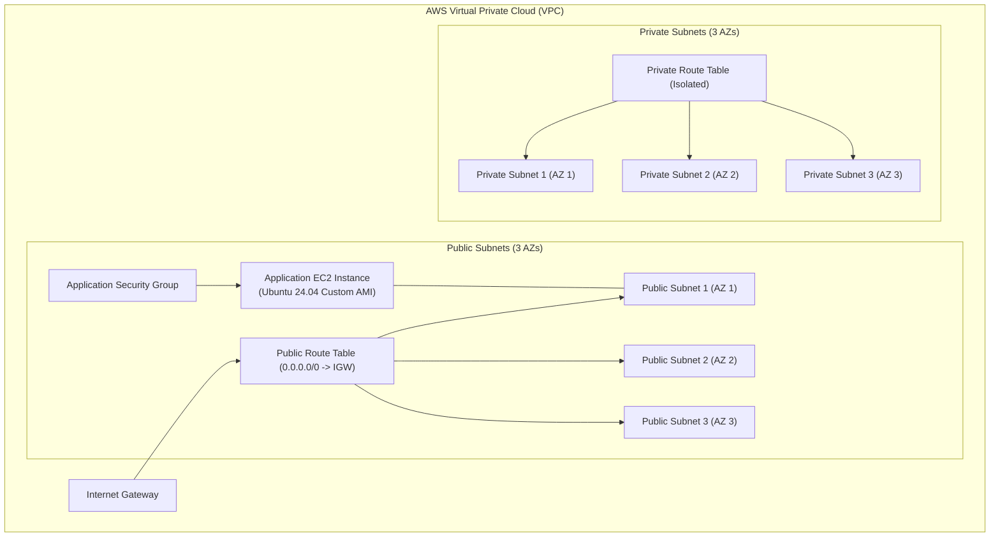

# AWS Cloud Infrastructure (Terraform)

This directory contains HashiCorp Terraform modules to automate the provisioning of a secure, multi-availability zone Virtual Private Cloud (VPC) on Amazon Web Services (AWS) along with application compute instances.

---

## Architecture

The Terraform configuration creates the following AWS resources:



### Components

1. **VPC**: Configured with DNS support and DNS hostnames enabled.
2. **Subnets**:
   - **Public Subnets**: 3 subnets spread across 3 availability zones with public IPv4 addressing enabled (`map_public_ip_on_launch = true`).
   - **Private Subnets**: 3 isolated subnets spread across the same 3 availability zones for backend components.
3. **Internet Gateway & Routing**:
   - Internet Gateway attached to the VPC.
   - Public route table routing `0.0.0.0/0` traffic to the Internet Gateway.
   - Dedicated private route table for isolated subnets without direct internet route.
4. **Security Group**:
   - Inbound ports: `22` (SSH), `80` (HTTP), `443` (HTTPS), and `8080` (Application service).
   - Database Port Restriction: PostgreSQL port `5432` is strictly **excluded** from the security group ingress to prevent internet exposure.
   - Outbound traffic: Unrestricted egress (`0.0.0.0/0`).
5. **EC2 Compute Instance**:
   - Instance Type: `t2.micro`.
   - Root Block Device: `25 GB` GP2 EBS volume configured with `delete_on_termination = true`.
   - Boot Image: Custom golden AMI built with HashiCorp Packer.

---

## File Structure

```text
tf-aws-infra/
├── .github/workflows/
│   └── terraform-ci.yml    # GitHub Actions workflow for PR format & validation checks
├── main.tf                 # Core infrastructure declarations (VPC, Subnets, Routing, SG, EC2)
├── variables.tf            # Input variable declarations and documentation
├── outputs.tf              # Exported resource identifiers
├── provider.tf             # AWS provider configuration
├── versions.tf             # Terraform and provider version requirements
├── terraform.tfvars        # Sample environment values (excluded from VCS if containing sensitive data)
└── README.md               # Infrastructure documentation
```

---

## Requirements

| Name | Version |
|------|---------|
| **Terraform** | `>= 1.6.0` |
| **AWS Provider** | `~> 6.0` |
| **AWS CLI** | `v2+` with configured profile |

---

## Input Variables

| Name | Type | Description | Example |
|------|------|-------------|---------|
| `aws_region` | `string` | AWS region where resources will be created | `"us-east-1"` |
| `aws_profile` | `string` | AWS CLI profile to use for authentication | `"dev"` |
| `vpc_cidr` | `string` | CIDR block for the custom VPC | `"10.0.0.0/16"` |
| `vpc_name` | `string` | Name prefix used for tagging resources | `"dev-vpc"` |
| `public_subnet_cidrs` | `list(string)` | CIDR blocks for public subnets (3 AZs) | `["10.0.1.0/24", "10.0.2.0/24", "10.0.3.0/24"]` |
| `private_subnet_cidrs` | `list(string)` | CIDR blocks for private subnets (3 AZs) | `["10.0.11.0/24", "10.0.12.0/24", "10.0.13.0/24"]` |
| `availability_zones` | `list(string)` | Availability zones corresponding to subnets | `["us-east-1a", "us-east-1b", "us-east-1c"]` |
| `ami_id` | `string` | ID of the custom golden AMI to boot | `"ami-0123456789abcdef0"` |

---

## Output Values

| Name | Description |
|------|-------------|
| `vpc_id` | ID of the created VPC |
| `public_subnet_ids` | List of IDs of created public subnets |
| `private_subnet_ids` | List of IDs of created private subnets |
| `internet_gateway_id` | ID of the Internet Gateway |
| `public_route_table_id` | ID of the public route table |
| `private_route_table_id` | ID of the private route table |

---

## Usage Instructions

### 1. Configure AWS CLI Profiles

To prevent unintentional modifications across accounts, configure named profiles and avoid using a `default` profile:

```bash
# Configure development profile
aws configure --profile dev

# Configure demonstration profile
aws configure --profile demo
```

Verify configured profiles:
```bash
aws sts get-caller-identity --profile dev
```

### 2. Configure Variables

Create or update your `terraform.tfvars`:

```hcl
aws_region  = "us-east-1"
aws_profile = "dev"
vpc_cidr    = "10.0.0.0/16"
vpc_name    = "dev-vpc"

public_subnet_cidrs = [
  "10.0.1.0/24",
  "10.0.2.0/24",
  "10.0.3.0/24"
]

private_subnet_cidrs = [
  "10.0.11.0/24",
  "10.0.12.0/24",
  "10.0.13.0/24"
]

availability_zones = [
  "us-east-1a",
  "us-east-1b",
  "us-east-1c"
]

ami_id = "ami-0123456789abcdef0"
```

### 3. Multi-VPC & Multi-Region Support

The configuration is fully parameterized with zero hardcoded names or CIDRs. You can provision multiple independent VPCs in the same account or across different regions by varying `vpc_name`, `vpc_cidr`, `public_subnet_cidrs`, and `private_subnet_cidrs` without naming or routing collisions.

### 4. Initialize & Validate

```bash
# Initialize working directory and download providers
terraform init

# Check formatting
terraform fmt -check

# Validate configuration syntax and schema
terraform validate
```

### 5. Plan & Apply

```bash
# Generate and inspect execution plan
terraform plan -out=tfplan

# Apply the infrastructure plan
terraform apply tfplan
```

### 6. Tear Down Resources

To destroy all managed AWS resources when finished:

```bash
terraform destroy
```

---

## Continuous Integration

A GitHub Actions workflow is located at `.github/workflows/terraform-ci.yml`. On every pull request targeting `main`:
1. Checks out the code.
2. Initializes Terraform with `-backend=false`.
3. Verifies code formatting via `terraform fmt -check -recursive`.
4. Validates configuration syntax with `terraform validate`.
