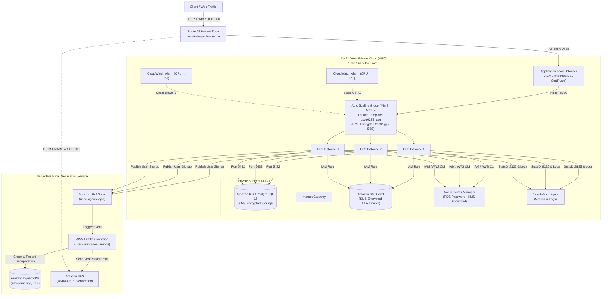

# AWS Cloud Infrastructure (Terraform)

This directory contains HashiCorp Terraform modules to automate the provisioning of an auto-scaling, highly available, secure cloud application stack on Amazon Web Services (AWS) using an Application Load Balancer with SSL termination, Launch Template, Auto Scaling Group, Customer-Managed KMS Keys with automatic rotation, AWS Secrets Manager, DynamoDB, SNS, Lambda, Route 53 DNS alias, RDS PostgreSQL, S3, and Amazon SES.

---

## Architecture



### Components

1. **VPC & Subnets**:
   - Custom VPC with DNS support and hostnames enabled.
   - **Public Subnets**: 3 public subnets distributed across 3 Availability Zones with automatic public IP assignment.
   - **Private Subnets**: 3 isolated private subnets across 3 Availability Zones for the PostgreSQL RDS database.
   - Internet Gateway attached with public route table (`0.0.0.0/0 -> IGW`).
2. **Security Groups**:
   - **Load Balancer Security Group**: Ingress on ports `80` (HTTP) and `443` (HTTPS) from `0.0.0.0/0`.
   - **Application Security Group**: Ingress on application port (`8080`) allowed **strictly from the Load Balancer Security Group**. Ingress on port `22` (SSH) is enabled for administration.
   - **Database Security Group**: Ingress on port `5432` allowed strictly and exclusively from the Application Security Group.
3. **AWS Key Management Service (KMS)**:
   - 4 dedicated Customer Managed Keys (CMKs) with **90-day automatic key rotation** (`rotation_period_in_days = 90`):
     - `kms/ec2`: Encrypts root EBS volumes attached to Auto Scaling EC2 instances.
     - `kms/rds`: Encrypts RDS PostgreSQL database storage and automated snapshots.
     - `kms/s3`: Encrypts private S3 bucket objects with server-side encryption.
     - `kms/secretsmanager`: Encrypts database credentials in AWS Secrets Manager.
4. **AWS Secrets Manager**:
   - Auto-generated 16-character random database password stored securely in AWS Secrets Manager.
   - Encrypted with the custom KMS Secrets Manager CMK.
   - EC2 user data automatically queries Secrets Manager at instance boot via AWS CLI to populate database credentials dynamically without hardcoding.
5. **Application Load Balancer & SSL Termination**:
   - Internet-facing ALB deployed across 3 public subnets.
   - **HTTPS 443 Listener**: Terminates SSL/TLS using either an ACM DNS-validated certificate (Dev) or an externally imported SSL certificate (Demo). Forwards traffic to the target group.
   - **HTTP 80 Listener**: Forwards incoming HTTP requests to the target group.
   - **Target Group**: Directs traffic to application port `8080` with health checks on `/healthz`.
6. **Launch Template (`csye6225_asg`) & Auto Scaling Group**:
   - Root Block Device: `25 GB` GP2 EBS volume encrypted with the custom EC2 KMS key.
   - Attached to the Application Security Group and IAM instance profile (CloudWatch, S3, Secrets Manager, and SNS permissions).
   - ASG scales between `3` (min) and `5` (max) instances with `60s` cooldown.
   - CloudWatch alarms trigger scale-up when average CPU > 5% and scale-down when average CPU < 3%.
7. **Amazon SNS & Serverless Lambda Verification**:
   - **SNS Topic** (`${var.vpc_name}-user-signup-topic`): Receives user creation events published by the web application.
   - **Lambda Function** (`${var.vpc_name}-user-verification-lambda`): Node.js 20.x runtime packaged from `../serverless`. Subscribed to the SNS topic.
   - **DynamoDB Tracking Table** (`${var.vpc_name}-email-tracking`): Deduplicates email notifications using `email` (Partition Key) and `token` (Sort Key) with a 120-second TTL.
   - **Amazon SES**: Lambda sends an account confirmation email containing the verification link (`http://${domain_name}/validateEmail?email=...&token=...`) via SES.
8. **Route 53 DNS & Email Authentication**:
   - Dynamically manages DNS records for `var.domain_name`.
   - Provisions an `A` record alias to the ALB DNS name.
   - Automatically provisions SES domain identity, 3 DKIM CNAME records, and SPF TXT record (`v=spf1 include:amazonses.com ~all`).
9. **Private S3 Bucket**:
   - UUID-named private S3 bucket encrypted with custom KMS S3 key.
   - Lifecycle rule transitions objects to `STANDARD_IA` after 30 days.
   - All public access strictly blocked.

---

## File Structure

```text
tf-aws-infra/
├── .github/workflows/
│   └── terraform-ci.yml    # GitHub Actions workflow for PR format & validation checks
├── main.tf                 # Core infrastructure (VPC, KMS, Secrets, ALB, ASG, S3, RDS, SNS, Lambda, DDB, SES, Route 53)
├── variables.tf            # Input variable declarations and defaults
├── outputs.tf              # Exported resource identifiers
├── provider.tf             # AWS provider configuration
├── versions.tf             # Terraform and provider version requirements (AWS ~> 5.0, archive ~> 2.4)
├── terraform.tfvars        # Environment variable definitions
└── README.md               # Infrastructure documentation
```

---

## Input Variables

| Name | Type | Description | Default |
|------|------|-------------|---------|
| `aws_region` | `string` | AWS region where resources will be created | `"us-east-1"` |
| `aws_profile` | `string` | AWS CLI profile to use for authentication | - |
| `vpc_cidr` | `string` | CIDR block for the custom VPC | `"10.0.0.0/16"` |
| `vpc_name` | `string` | Name prefix used for tagging resources | - |
| `public_subnet_cidrs` | `list(string)` | CIDR blocks for public subnets (3 AZs) | - |
| `private_subnet_cidrs` | `list(string)` | CIDR blocks for private subnets (3 AZs) | - |
| `availability_zones` | `list(string)` | Availability zones corresponding to subnets | - |
| `ami_id` | `string` | ID of the custom golden AMI to boot | - |
| `domain_name` | `string` | Subdomain for Route 53 zone (e.g. `dev.akshaymchavan.me`) | - |
| `key_name` | `string` | EC2 Key Pair name for SSH access | `null` |
| `instance_type` | `string` | EC2 instance type for launch template | `"t2.micro"` |
| `app_port` | `number` | Port on which the Spring Boot application listens | `8080` |
| `asg_min_size` | `number` | Minimum number of instances in ASG | `3` |
| `asg_max_size` | `number` | Maximum number of instances in ASG | `5` |
| `asg_desired_capacity` | `number` | Desired number of instances in ASG | `3` |
| `ssl_certificate_arn` | `string` | Optional ARN of an externally imported SSL certificate (Demo) | `""` |

---

## Output Values

| Name | Description |
|------|-------------|
| `vpc_id` | ID of the created VPC |
| `public_subnet_ids` | List of IDs of created public subnets |
| `private_subnet_ids` | List of IDs of created private subnets |
| `kms_ec2_key_arn` | ARN of the EC2 customer-managed KMS key |
| `kms_rds_key_arn` | ARN of the RDS customer-managed KMS key |
| `kms_s3_key_arn` | ARN of the S3 customer-managed KMS key |
| `kms_secrets_key_arn` | ARN of the Secrets Manager customer-managed KMS key |
| `secrets_manager_db_secret_arn` | ARN of the AWS Secrets Manager DB credentials secret |
| `s3_bucket_name` | Name of the KMS-encrypted S3 bucket |
| `rds_endpoint` | Endpoint of the RDS PostgreSQL instance |
| `sns_topic_arn` | ARN of the SNS topic for user signups |
| `dynamodb_table_name` | Name of the DynamoDB email tracking table |
| `lambda_function_arn` | ARN of the user verification Lambda function |
| `alb_dns_name` | DNS name of the Application Load Balancer |
| `route53_app_fqdn` | FQDN of the Route 53 A record alias pointing to ALB |
| `ssl_certificate_arn` | ARN of the active SSL certificate used by ALB HTTPS listener |
| `autoscaling_group_name` | Name of the Auto Scaling Group |
| `launch_template_name` | Name of the Launch Template |

---

## SSL Certificate Configuration

### Dev Environment (AWS Certificate Manager DNS Validation)
In the `dev` environment, Terraform automatically requests a public SSL certificate from AWS Certificate Manager (ACM) for `var.domain_name` and validates it via Route 53 DNS records. Leave `ssl_certificate_arn = ""` in `terraform.tfvars`.

### Demo Environment (Import External SSL Certificate)
In the `demo` environment, obtain an SSL certificate from an external provider (such as Namecheap) and import it into ACM using the AWS CLI:

```bash
aws acm import-certificate \
    --certificate fileb://certificate.crt \
    --private-key fileb://private.key \
    --certificate-chain fileb://ca_bundle.crt \
    --region us-east-1 \
    --profile demo
```

After importing, copy the resulting `CertificateArn` and configure `ssl_certificate_arn` in `terraform.tfvars`:

```hcl
ssl_certificate_arn = "arn:aws:acm:us-east-1:422783588667:certificate/xxxxxxxx-xxxx-xxxx-xxxx-xxxxxxxxxxxx"
```

The Application Load Balancer HTTPS listener on port 443 will automatically attach this imported certificate.

---

## Verification & Usage

### 1. Initialize & Validate
```bash
terraform init
terraform fmt -check
terraform validate
```

### 2. Plan Infrastructure
```bash
terraform plan
```

### 3. Apply Infrastructure
```bash
terraform apply
```

### 4. Verify Route 53 DNS & HTTPS Access
```bash
# Query A record alias
dig A dev.akshaymchavan.me

# Verify HTTPS healthz check
curl -i https://dev.akshaymchavan.me/healthz

# Verify HTTP port 80 healthz check
curl -i http://dev.akshaymchavan.me/healthz
```
